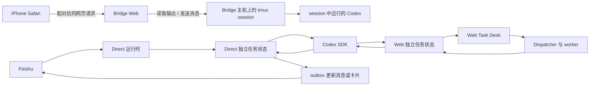

# Feishu Codex Bridge

一个个人维护的自托管开发工作台，把 Mac 上运行的 Codex 工作流连接到 iPhone 浏览器和飞书。

**主要场景：** Codex 在 MacBook 上通过 tmux 工作时，人离开电脑也可以用 iPhone 查看会话、追加提示，并继续检查结果。Codex 仍运行在自己的 Mac 上；Bridge 不提供云端执行环境。

本项目不是飞书或 OpenAI 的官方产品。作者已在自己的 MacBook 和 iPhone 场景中持续自用；其他人的网络、公司策略和安装环境需要自行验证。

## 能做什么

| 功能 | 用途 |
| --- | --- |
| Tmux Dashboard | 从手机或浏览器查看 Bridge 主机上已有的 tmux session，向选中的 Codex session 发送消息，并浏览该 session 工作目录中的文件。 |
| 飞书 Direct | 从飞书提交文字、图片或文件任务，查看执行状态、续问或取消任务。 |
| Web Task Desk | 从浏览器为已登记项目创建 Codex 任务，查看运行记录、附加文件、续问和处理支持的重试/审核操作。 |
| Codex History | 搜索不同 Codex home 的会话，并通过 Codex SDK 继续已有会话。 |
| 设备与运维 | 配对和撤销浏览器设备，查看运行状态，并创建、校验和恢复数据备份。 |

Tmux Dashboard 的 Composer 是给选中的 Codex session 发送消息，不是可输入任意 shell 命令的终端。它连接的是 Bridge 主机上的 tmux，不会进入 pane 里可能通过 SSH 登录的另一台机器。

## 工作方式



手机接续 tmux、飞书 Direct 和 Web Task Desk 是不同入口。Direct 与 Web 任务保留各自的状态流程；图中的 Codex SDK 表示它们使用同一 SDK 执行器类型，不表示任务记录合并。Codex History 则通过 Codex app-server 读取会话，通过 Codex SDK 继续会话。

## 使用前提

- 一台运行 Bridge、Codex 和 tmux 的主机。tmux Dashboard 连接这台主机上已有的 session。
- Codex CLI/App 已登录并可正常使用。
- iPhone 或其他浏览器能够访问 Bridge。主机和服务需要在使用期间保持运行。
- 若要从飞书提交任务，还需要配置自己的飞书应用和 Direct 运行时；手机 Dashboard 本身不要求把飞书任务入口作为同一条流程。

## 安装与首次使用

### 从源码安装

需要 Bun 1.4.2 或更高版本。进入项目目录后运行：

```bash
bun install
bun link --global
feishu-codex-bridge install
```

安装器会检查 Codex CLI 并引导初始化配置。使用飞书 Direct 时，选择原生直连模式（feishu-sqlite-codex），并通过本机环境或安装器配置飞书凭据；不要把 App Secret 提交到仓库。

### 使用 Portable 包

没有单独安装 Bun 时，可使用项目发布的 Portable 包。在 macOS 上运行包内的 `install.command`，并按安装器提示完成配置。请根据发布页中的说明选择适用架构。

### 从 iPhone 打开 Dashboard

1. 在 Mac 上启动 Bridge，并确认 Tmux Dashboard 可用。若手机需要通过局域网访问，先按下方说明显式启用 LAN 监听。
2. 在 Mac 上运行 `feishu-codex-bridge web:pair`，按命令提示完成浏览器配对。
3. 在 iPhone Safari 打开配对时显示的 Bridge 地址，并进入 `/tmux-dashboard`。

Bridge 的生产服务默认只监听本机回环地址。若确实需要从局域网访问，必须显式启用 LAN 监听（`FEISHU_CODEX_BRIDGE_LAN_BIND=1`），同时仍需配对认证。不要将服务直接暴露到公网；按所在组织的网络和安全要求配置访问。

## 数据与安全边界

- 配对会话保护受保护的网页和 API；设备可以在配对管理页撤销。
- 数据库、任务状态和 Bridge 管理的附件保存在运行 Bridge 的主机上。
- 飞书任务内容会经过飞书服务；Codex 提示和附件会按当前 Codex 配置发送给相应服务处理。因此，自托管不等于离线或所有数据都只在本机流转。
- 处理公司代码前，先确认公司关于 Codex、飞书、网络访问和数据分类的要求。
- Composer 只把消息发给选中的 Codex session；服务端按 session 工作目录确定文件页根目录，并校验文件路径。

## 可选运行模式

新安装或首次接入飞书任务时，优先使用原生 Direct 模式（`feishu-sqlite-codex`）。已有 AAMP + Relay 部署仍可继续使用 `aamp-relay`；它是兼容现有环境的可选路径，不是手机 Dashboard、Web Task Desk 或 Codex History 的前置条件。不要让同一个飞书 Bot 同时连接两个运行时。

## 开发与资料

```bash
bun run typecheck
bun run test
bun run build
```

- [功能路线图](doc/product-review-roadmap.md)
- [阶段交付与验证记录](doc/phase-one-checklist.md)
- [浏览器验收清单](doc/browser-smoke-checklist.md)
- [内部演示资料](doc/internal-pilot/README.md)
- [变更记录](CHANGELOG.md)
