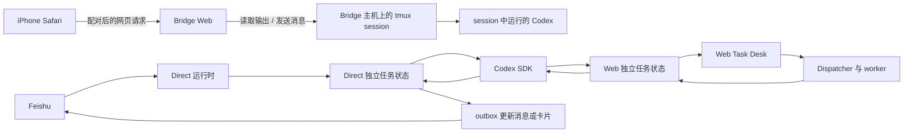

# Feishu Codex Bridge

一个个人维护的自托管开发工作台，把 Mac 上运行的 Codex 工作流连接到 iPhone 浏览器和飞书。

**主要场景：** Codex 在 MacBook 上通过 tmux 工作时，人离开电脑也可以用 iPhone 查看会话、追加提示，并继续检查结果。Codex 仍运行在自己的 Mac 上；Bridge 不提供云端执行环境。

本项目不是飞书或 OpenAI 的官方产品。作者已在自己的 MacBook 和 iPhone 场景中持续自用；其他人的网络、公司策略和安装环境需要自行验证。

## 能做什么

| 功能 | 用途 |
| --- | --- |
| Tmux Dashboard | 从手机或浏览器查看 Bridge 主机上已有的 tmux session，向选中的 Codex session 发送消息，并浏览该 session 工作目录中的文件；可用 `tmux-resurrect` + `tmux-continuum` 按 Session 保存、挂起和恢复 Mac 重启前的状态。 |
| 飞书 Direct | 从飞书提交文字、图片或文件任务，查看执行状态、续问或取消任务。 |
| Web Task Desk | 从浏览器为已登记项目创建 Codex 任务，查看运行记录、附加文件、续问和处理支持的重试/审核操作。 |
| Codex History | 搜索不同 Codex home 的会话，并通过 Codex SDK 继续已有会话。 |
| 本机 Demo | 从统一目录发现并打开 Bridge 主机上运行的本地模型/实验 Demo；入口通过 Bridge 代理，不要求手机直连 Demo 的 Python 端口。 |
| 上传下载 | 系统管理 → 上传下载，支持多选上传、进度、取消和同名自动编号；也可提交链接，由 Mac 通过配置的 VPN/HTTP/SOCKS 代理预览或下载。文件保存到 `~/Downloads`。 |
| 设备与运维 | 配对和撤销浏览器设备，查看运行状态；每天凌晨 1 点自动备份 SQLite，也可手动创建、校验和恢复。 |

Tmux Dashboard 默认通过 Composer 给选中的 Codex session 发送消息；需要执行 Shell 命令或操作全屏终端程序时，可以显式开启“终端输入”模式，让 xterm 按键直接进入当前 tmux session。两种输入入口彼此独立。它连接的是 Bridge 主机上的 tmux，不会进入 pane 里可能通过 SSH 登录的另一台机器。

tmux 快照安装与进程恢复白名单见 [tmux Session 快照说明](doc/tmux-resurrect.md)。

## 工作方式



手机接续 tmux、飞书 Direct 和 Web Task Desk 是不同入口。Direct 与 Web 任务保留各自的状态流程；图中的 Codex SDK 表示它们使用同一 SDK 执行器类型，不表示任务记录合并。Codex History 则通过 Codex app-server 读取会话，通过 Codex SDK 继续会话。

## 使用前提

- 一台运行 Bridge、Codex 和 tmux 的主机。tmux Dashboard 连接这台主机上已有的 session。
- Codex CLI/App 已登录并可正常使用。
- iPhone 或其他浏览器能够访问 Bridge。主机和服务需要在使用期间保持运行。
- 若要从飞书提交任务，还需要配置自己的飞书应用和 Direct 运行时；手机 Dashboard 本身不要求把飞书任务入口作为同一条流程。

## 安装与首次使用

### 从源码安装

需要 Bun 1.4.2 或更高版本。进入项目目录后运行：

```bash
bun install
bun link --global
feishu-codex-bridge install
```

安装器会检查 Codex CLI 并引导初始化配置。使用飞书 Direct 时，选择原生直连模式（feishu-sqlite-codex），并通过本机环境或安装器配置飞书凭据；不要把 App Secret 提交到仓库。

### 使用 Portable 包

没有单独安装 Bun 时，可使用项目发布的 Portable 包。在 macOS 上运行包内的 `install.command`，并按安装器提示完成配置。请根据发布页中的说明选择适用架构。

### 从 iPhone 打开 Dashboard

1. 在 Mac 上启动 Bridge，并确认 Tmux Dashboard 可用。若手机需要通过局域网访问，先按下方说明显式启用 LAN 监听。
2. 在 Mac 上运行 `feishu-codex-bridge web:pair`，按命令提示完成浏览器配对。
3. 在 iPhone Safari 打开配对时显示的 Bridge 地址，并进入 `/tmux-dashboard`。

配对后也可以进入 `/demos`，从“本机 Demo”目录启动或打开本机实验页面。当前目录包含食物拍照 Fast Path 和 OpenAI CLIP + SQLite-vec 两个 Demo；Bridge 通过固定代理目标访问，启动按钮只允许启动登记的本机脚本，不接受浏览器传入的任意命令。
配对后进入“系统管理 → 上传下载”（`/system-management/uploads`），可上传本地文件或切换到“链接下载”预览与下载链接；旧 `/link-tools` 地址会跳转到链接下载标签。链接只处理 `http://` 和 `https://`，预览限制为图片、PDF 和文本类内容；HTML 以安全文本显示，不执行远程脚本。下载由 Mac 保存到 `~/Downloads`，优先使用 `codex.env.HTTP_PROXY/HTTPS_PROXY`，未配置时沿用 Bridge 进程的网络环境。

文件上传使用可恢复的分块流：浏览器和 Composer 默认使用最多 3 个并发的 8 MiB 分片，服务端分别写入临时分片并在完成时按序合并；旧客户端仍可使用单 offset 分块协议。客户端会重试已提交但响应丢失的分片，并在完成接口超时后查询结果。Composer 会显示读取、上传、分块确认和保存阶段，上传失败会保留草稿并给出错误；这条链路不使用单请求 35 MiB 缓冲。

“上传下载”页面的上传队列由全局上传管理器持有，切换任务、History 或系统管理页面不会卸载或取消任务；完成后会显示全局提示，并在浏览器已授权通知时发送系统通知。

Bridge 的生产服务默认只监听本机回环地址。若确实需要从局域网访问，必须显式启用 LAN 监听（`FEISHU_CODEX_BRIDGE_LAN_BIND=1`），同时仍需配对认证。不要将服务直接暴露到公网；按所在组织的网络和安全要求配置访问。

### Android / iOS App（首版）

App 使用 Capacitor，复用现有 React 工作台，并把页面资源放进安装包。手机配对后远程访问 Mac 上的 Bridge；Codex、tmux 和仓库继续在 Mac 上运行。

```bash
bun run mobile:doctor
bun run mobile:build
bun run mobile:open:ios
# 或 bun run mobile:open:android
```

`mobile:build` 构建手机前端并同步两个原生工程，不会生成已签名 APK/IPA。iOS 需要完整 Xcode 26+ 和签名，Android 需要 JDK 21、SDK 36，并要求 Android 8（API 26）或更高版本以支持扫码配对。Android App 会在 Bridge 上的 APK 被重新编译后提示更新，也可以从连接页手动下载 APK 保存后安装。当前已生成原生源码，安装包编译、签名安装和真机验收尚待具备环境后完成。首次连接、文件分享、扫码配对、App 更新、凭据存储和构建步骤见 [手机 App 指南](doc/mobile-app.md)。

## 数据与安全边界

- 配对会话保护受保护的网页和 API；设备可以在配对管理页撤销。
- 数据库、任务状态和 Bridge 管理的附件保存在运行 Bridge 的主机上。
- 飞书任务内容会经过飞书服务；Codex 提示和附件会按当前 Codex 配置发送给相应服务处理。因此，自托管不等于离线或所有数据都只在本机流转。
- 处理公司代码前，先确认公司关于 Codex、飞书、网络访问和数据分类的要求。
- Composer 只把消息发给选中的 Codex session；“终端输入”模式会把原始按键直接发给当前 tmux PTY。服务端按 session 工作目录确定文件页根目录，并校验文件路径。

数据备份仅保存 Bridge SQLite 数据库及校验清单，不复制附件或其他文件。服务运行期间按主机时区每天 01:00 创建带时间戳的系统定时备份；备份成功后按日期清理 3 天前的定时备份，始终保留最近 3 个成功副本，手动备份保留。主机休眠或服务停机后，在当日 01:00 之后恢复运行会补做当日备份。新旧备份均只恢复数据库到全新目录，保留库内原有附件路径。命令与使用边界见[备份说明](doc/phase-one-checklist.md#命令与使用边界)。

## 可选运行模式

新安装或首次接入飞书任务时，优先使用原生 Direct 模式（`feishu-sqlite-codex`）。已有 AAMP + Relay 部署仍可继续使用 `aamp-relay`；它是兼容现有环境的可选路径，不是手机 Dashboard、Web Task Desk 或 Codex History 的前置条件。不要让同一个飞书 Bot 同时连接两个运行时。

## 开发与资料

```bash
bun run typecheck
bun run test
bun run build
```

- [功能路线图](doc/product-review-roadmap.md)
- [阶段交付与验证记录](doc/phase-one-checklist.md)
- [浏览器验收清单](doc/browser-smoke-checklist.md)
- [内部演示资料](doc/internal-pilot/README.md)
- [变更记录](CHANGELOG.md)
