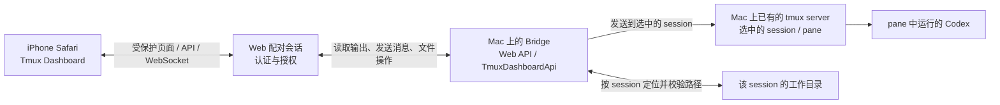
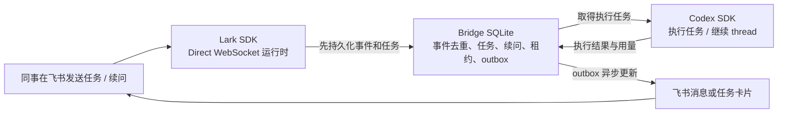

# 架构图

## 1. iPhone 接续 Mac 上已有的 Codex session

这是第一场内部演示的主流程。Codex 继续运行在 Mac 上；iPhone 浏览器通过 Bridge 查看并向选中的 session 发送消息。

边界说明：

- Dashboard 连接 Bridge 主机上的现有 tmux server，不代表 pane 里通过 SSH 登录的其他机器。
- Composer 是给所选 Codex session 发送消息；它不提供任意 shell 命令入口。
- 文件根目录由服务端按 session 工作目录确定；客户端不能指定任意目录。
- 网页需要配对会话。若通过局域网访问，按实际 Bridge 配置和公司网络政策开放；不要把配对码或管理页面公开。

## 2. 飞书 Direct 任务入口（可选，建议单独演示）

Direct 与 tmux Dashboard 是不同的入口和状态流程。AAMP + Relay 也是另一种运行模式，本图没有把它们合并进 Direct。
